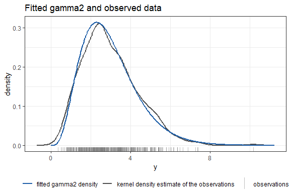
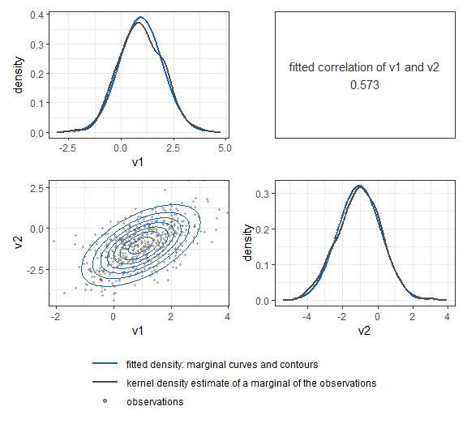

# distributions7

Almost every R package that fits statistical models writes its own
distributions, privately: a `switch` on a character string, or a list of
closures that only the package itself can reach. The same Gamma is
therefore re-implemented again and again, each time only as far as that
package happened to need it: the density and the score, sometimes the
Hessian, rarely anything beyond.

[distributions7](https://statmodels7.github.io/distributions7/) writes
them once, as objects. Each carries the usual density, distribution and
quantile functions, together with the exact derivatives of the
log-likelihood up to fourth order, and a fifth order that is closed form
for some families and one central difference of the analytic fourth
order for the others. The derivatives are available with respect to the
parameters, with respect to the response, and with respect to the
unconstrained parameters behind a link function, which is the scale on
which an optimizer works.

It is the distribution layer of
[statmodels7](https://statmodels7.github.io), an S7 toolkit for
statistical modeling, and works alongside
[linkfunctions7](https://statmodels7.github.io/linkfunctions7/). The
mathematics behind every formula, from the likelihood theory and the
change of scale to the derivations for the zero-inflated, zero-adjusted,
truncated and transformed wrappers, is worked out in [the statmodels7
book](https://statmodels7.github.io/book/).

## Installation

``` r

# install.packages("pak")
pak::pak("statmodels7/distributions7")
```

Alternatively, the following call installs the whole toolkit, that is,
[distributions7](https://statmodels7.github.io/distributions7/) together
with the other packages of the toolkit:

``` r

pak::pak("statmodels7/statmodels7")
```

## The usual functions

The package carries 43 univariate distributions and 6 multivariate ones,
one name per parametrization where a family has several
([`gaussian1_distrib()`](https://statmodels7.github.io/distributions7/reference/gaussian1_distrib.md)
in mean and scale,
[`gaussian2_distrib()`](https://statmodels7.github.io/distributions7/reference/gaussian2_distrib.md)
in mean and variance,
[`gaussian3_distrib()`](https://statmodels7.github.io/distributions7/reference/gaussian3_distrib.md)
in mean and precision, and likewise for 14 other families). Each
constructor takes the link functions used for its parameters, and
parameters travel as a named list.

``` r

d <- gaussian1_distrib()
theta <- list(mu = 2, sigma = 3)

distrib_pdf(d, c(0, 2, 4), theta)
#> [1] 0.1064827 0.1329808 0.1064827
distrib_cdf(d, c(0, 2, 4), theta)
#> [1] 0.2524925 0.5000000 0.7475075
distrib_quantile(d, c(0.025, 0.5, 0.975), theta)
#> [1] -3.879892  2.000000  7.879892
```

## Moments

The moments of a distribution are computed on request: the mean, the
variance, the standard deviation, the skewness and the excess kurtosis,
from a closed form where the family has one and by quadrature against
the density otherwise.
[`moment()`](https://statmodels7.github.io/distributions7/reference/moment.md)
computes a moment of any order, raw or central.

``` r

# sigma^2 and 3 sigma^4 at the even orders; the odd ones vanish, and they
# vanish to the accuracy of the quadrature that produced them rather than
# because a table said so
moment(d, theta, p = 1:4, central = TRUE)
#> [1]   0   9   0 243
c(skewness = skewness(d, theta), kurtosis = kurtosis(d, theta))
#> skewness kurtosis 
#>        0        0
```

Every moment returns one value per parameter setting, so a component
given as a vector gives one moment per element, and the result can be
bound to the rows of that vector. This holds also when the varied
parameter does not enter the formula: the skewness of a Weibull depends
only on its shape, and three scales still give three values.

``` r

w <- weibull1_distrib()
skewness(w, list(mu = c(0.1, 1, 100), sigma = 2))
#> [1] 0.6311107 0.6311107 0.6311107
```

`theta` is read by name and not by position here as everywhere else, so
the components may be written in any order.

``` r

identical(mean(d, list(mu = 2, sigma = 3)),
          mean(d, list(sigma = 3, mu = 2)))
#> [1] TRUE
```

## Derivatives

The score, the observed and expected information, and the third and
fourth order derivatives are all closed form.

``` r

y <- distrib_rng(d, 5, theta)

distrib_gradient(d, y, theta)
#> $mu
#> [1] -0.20881794  0.06121444 -0.27854287  0.53176027  0.10983592
#> 
#> $sigma
#> [1] -0.2025185 -0.3220917 -0.1005749  0.5149736 -0.2971415
distrib_expected_hessian(d, 0, theta)
#> $mu_mu
#> [1] -0.1111111
#> 
#> $sigma_sigma
#> [1] -0.2222222
#> 
#> $mu_sigma
#> [1] 0
```

On the link scale the same generics return derivatives with respect to
the unconstrained parameters instead, computed through the chain rule
rather than by differentiating numerically:

``` r

distrib_gradient(d, y, theta, scale = "link")
#> $mu
#> [1] -0.20881794  0.06121444 -0.27854287  0.53176027  0.10983592
#> 
#> $sigma
#> [1] -0.6075556 -0.9662751 -0.3017248  1.5449208 -0.8914246
```

## Fitting

[`fit_distrib()`](https://statmodels7.github.io/distributions7/reference/fit_distrib.md)
maximizes the likelihood on the link scale, where the parameters are
unconstrained, then reports estimates back on their natural scale.
Confidence intervals are built on the link scale and mapped through
$`g^{-1}`$, so they can never leave a parameter’s domain.

``` r

y <- distrib_rng(gamma2_distrib(), 500, list(mu = 3, sigma2 = 2))
fit <- fit_distrib(gamma2_distrib(), y)
fit
#> Maximum-likelihood fit: gamma2
#> Observations: 500   Log-likelihood: -841.2   AIC: 1686   BIC: 1695
#> Method: Fisher scoring   iterations: 2   evaluations: f 3, g 3   time: 30 ms
#> Converged: yes (gradient (max-norm) < 1e-06)
#> 
#> Parameter scale:
#>        Estimate Std. Error   2.5%  97.5%
#> mu       2.9570     0.0631 2.8359 3.0832
#> sigma2   1.9888     0.1480 1.7188 2.3011
#> 
#> Link scale:
#>        Estimate Std. Error   2.5%  97.5%
#> mu       1.0842     0.0213 1.0424 1.1260
#> sigma2   0.6875     0.0744 0.5416 0.8334
```

The fit carries the data from which it was estimated, so it can be
checked against the data and used to simulate new data:

``` r

plot(fit)
```



``` r

sims <- simulate(fit, 100, seed = 1)
quantile(vapply(sims, median, numeric(1)), c(0.025, 0.975))
#>     2.5%    97.5% 
#> 2.570081 2.881259
```

The optimization itself is delegated to
[optimizers7](https://statmodels7.github.io/optimizers7/). The argument
`method` selects the optimization. It accepts an optimizer of that
package, which brings its own stopping rule;
[`fisher_scoring()`](https://statmodels7.github.io/distributions7/reference/fisher_scoring.md),
which is Newton’s method with the expected information and records how
that information is approximated when the family has no closed form for
it; or one of the names `"fisher"`, `"newton"` and `"bfgs"`.

``` r

fit2 <- fit_distrib(gamma2_distrib(), y,
                    method = optimizers7::lbfgs(
                      criterion = optimizers7::crit_grad(1e-12)))
c(fisher = as.numeric(logLik(fit)), lbfgs = as.numeric(logLik(fit2)))
#>    fisher     lbfgs 
#> -841.2326 -841.2326
```

The starting values of a fit come from
[`distrib_start()`](https://statmodels7.github.io/distributions7/reference/distrib_start.md).
A family with a known estimator returns it, and the fit begins there; a
univariate family takes its first start from the moments of the data and
its other starts at random.

``` r

d4 <- mvgaussian1_distrib(4)
y4 <- as.matrix(iris[, 1:4])
f4 <- fit_distrib(d4, y4)
c(iterations = f4@iterations, converged = f4@converged)
#> iterations  converged 
#>          1          1
```

## Several dimensions

A multivariate distribution carries a mean vector and a matrix, and the
matrix comes from a structure of
[parameters7](https://statmodels7.github.io/parameters7/). Its free
values are scalars, so the parameter vector is a named list of numbers
exactly as above and every generic here applies unchanged, including
[`fit_distrib()`](https://statmodels7.github.io/distributions7/reference/fit_distrib.md).
The names indicate which matrix the structure describes, `sigma_` for a
covariance and `omega_` for a precision, because the same structure on
the two sides is two different models.

``` r

dm <- mvgaussian1_distrib(2)
dm@params
#> [1] "mu1"          "mu2"          "sigma_log_L1" "sigma_log_L2" "sigma_L2.1"

ym <- distrib_rng(dm, 500, list(mu1 = 1, mu2 = -1, sigma_log_L1 = 0, sigma_log_L2 = 0,
                                sigma_L2.1 = 0.7))
fitm <- fit_distrib(dm, ym)
mv_sigma(dm, coef(fitm))
#>           v1        v2
#> v1 1.0476959 0.7273189
#> v2 0.7273189 1.5380692
```

Those free values are the coordinates in which an optimizer moves, and
they are not the quantities that the fit reports.
[`mv_summary()`](https://statmodels7.github.io/distributions7/reference/mv_summary.md)
carries the fit’s variance matrix onto the standard deviations and the
correlations, by the delta method, and builds each interval on the scale
that keeps it in its own set: a standard deviation on the log scale, a
correlation on Fisher’s *z*. A precision parametrization reports the
conditional variances and the partial correlations instead, because
these are the quantities that it describes directly; the marginal matrix
remains available from
[`mv_sigma()`](https://statmodels7.github.io/distributions7/reference/mv_sigma.md).

``` r

mv_summary(fitm)
#>            Estimate Std. Error      2.5%     97.5%
#> sd_v1     1.0235702 0.03236813 0.9620558 1.0890178
#> sd_v2     1.2401892 0.03921823 1.1656565 1.3194875
#> cor_v1_v2 0.5729534 0.03004043 0.5111287 0.6288798
```

Up to three coordinates the fit can be drawn, and each panel shows a
marginal: the fitted density against a kernel estimate on the diagonal,
and contours against the observations below it.

``` r

plot(fitm)
```



[`mvstudent_t1_distrib()`](https://statmodels7.github.io/distributions7/reference/mvstudent_t1_distrib.md)
is the heavy-tailed alternative, in which the degrees of freedom are
estimated alongside everything else. Its
[`mv_sigma()`](https://statmodels7.github.io/distributions7/reference/mv_sigma.md)
is the scale matrix and its
[`variance()`](https://statmodels7.github.io/distributions7/reference/variance.md)
the covariance, which differ by the factor $`\nu/(\nu-2)`$. The two are
reported separately, so that the family remains usable at two degrees of
freedom or fewer, where the covariance does not exist.

Two families are not elliptical.
[`dirichlet_distrib()`](https://statmodels7.github.io/distributions7/reference/dirichlet_distrib.md)
lives on the simplex, written in a mean vector (a `parameters7` simplex)
and a concentration, and its marginals are beta with that same
concentration.
[`multinomial_distrib()`](https://statmodels7.github.io/distributions7/reference/multinomial_distrib.md)
is discrete, and because it is discrete it can enumerate its support:
[`mv_support()`](https://statmodels7.github.io/distributions7/reference/mv_support.md)
returns every vector of counts summing to the size, so its normalization
and its expected information are exact sums rather than samples.

``` r

dm <- multinomial_distrib(3, size = 5)
th <- list(probs_alr1 = 0.3, probs_alr2 = -0.2)
sum(distrib_pdf(dm, mv_support(dm, th), th))
#> [1] 1
```

## A user-defined distribution needs only its density

Everything above has a numerical fallback registered on the base
classes: the distribution function by quadrature, the quantile function
by root finding, the generator by Generalized Ratio-of-Uniforms, and
every derivative by finite differences. So a new distribution is a
subclass and one method.

``` r

MyLaplace <- S7::new_class("MyLaplace", parent = continuous_distrib)

S7::method(distrib_pdf, MyLaplace) <- function(distrib, y, theta, log = FALSE, ...) {
  ld <- -log(2 * theta$b) - abs(y - theta$mu) / theta$b
  if (log) ld else exp(ld)
}

d2 <- MyLaplace(
  distrib_name = "my laplace", dimension = "univariate", bounds = c(-Inf, Inf),
  params = c("mu", "b"), params_interpretation = c(mu = "location", b = "scale"),
  n_params = 2, params_bounds = list(mu = c(-Inf, Inf), b = c(0, Inf)),
  link_params = list(
    mu = linkfunctions7::identity_link(),
    b  = linkfunctions7::log_link()
  )
)

# These methods were never implemented, yet they are available.
distrib_cdf(d2, 1, list(mu = 0, b = 2))
#> [1] 0.6967347
distrib_gradient(d2, 1, list(mu = 0, b = 2))
#> $mu
#> [1] 0.5
#> 
#> $b
#> [1] -0.25
```

See
[`vignette("defining-a-distribution")`](https://statmodels7.github.io/distributions7/articles/defining-a-distribution.md)
for the full treatment, including what to do when a parameter is not
differentiable.

## Validating a distribution

[`check_distrib()`](https://statmodels7.github.io/distributions7/reference/check_distrib.md)
puts a univariate distribution through a battery of numerical checks. It
verifies that the density integrates to one, that the distribution
function agrees with it, that the quantile function inverts it, and that
the generator follows it. It also compares every derivative that the
family implements with finite differences, on the parameter and the link
scale; a derivative order that the family leaves to the fallbacks is
listed as not run, since both sides of the comparison would be the same
arithmetic.

``` r

invisible(check_distrib(d2, list(mu = 0, b = 2), nsim = 2e4))
#> Distribution: my laplace
#> Parameters:   mu = 0, b = 2
#> Observations: 100   Monte Carlo: 20000
#> 
#>   [OK  ] density integrates to 1                     1.81e-10
#>   [OK  ] density is non-negative                     5.00e-03
#>   [OK  ] cdf in [0,1] and non-decreasing             2.46e-02
#>   [OK  ] cdf agrees with the density                 3.78e-07
#>   [OK  ] quantile/cdf round-trip                     1.11e-16
#>   [OK  ] rng matches the cdf                         1.68e+00
#>   [OK  ] expected information vs Monte Carlo         2.30e+00
#>   [OK  ] response derivatives vs finite differences  5.52e-09
#>   [OK  ] link-scale gradient vs finite differences   3.24e-09
#>   [ -- ] gradient vs finite differences              not run
#>          no method of the family's own: the value is the numerical fallback, which this check would compare with itself
#>   [ -- ] hessian vs finite differences               not run
#>          no method of the family's own: the value is the numerical fallback, which this check would compare with itself
#>   [ -- ] deriv3 vs finite differences                not run
#>          no method of the family's own: the value is the numerical fallback, which this check would compare with itself
#>   [ -- ] deriv4 vs finite differences                not run
#>          no method of the family's own: the value is the numerical fallback, which this check would compare with itself
#> 
#> All 9 checks passed.
#> 4 checks not run, for the reasons given above.
```

## What is in the box

|  |  |
|----|----|
| continuous | gaussian, cauchy, logistic, Student’s t, Laplace, elastic net, pseudo-Huber, skew normal, skew t, gamma, generalized gamma, inverse gaussian, lognormal, exponential, chi-squared, Weibull, Gumbel, generalized Pareto, beta, von Mises |
| discrete | bernoulli, binomial, beta-binomial, poisson, geometric, negative binomial in both the quadratic and the linear variance parametrization, Poisson-inverse Gaussian |
| multivariate | [`mvgaussian1_distrib()`](https://statmodels7.github.io/distributions7/reference/mvgaussian1_distrib.md) and [`mvgaussian2_distrib()`](https://statmodels7.github.io/distributions7/reference/mvgaussian1_distrib.md), parametrized by a covariance and by a precision structure respectively from [parameters7](https://statmodels7.github.io/parameters7/); [`mvstudent_t1_distrib()`](https://statmodels7.github.io/distributions7/reference/mvstudent_t1_distrib.md) and [`mvstudent_t2_distrib()`](https://statmodels7.github.io/distributions7/reference/mvstudent_t1_distrib.md) on the scale matrix and on its inverse, which keep the scale matrix and the covariance apart so that the family is usable where the second moment does not exist; [`dirichlet_distrib()`](https://statmodels7.github.io/distributions7/reference/dirichlet_distrib.md) on the simplex, whose marginals are beta; and [`multinomial_distrib()`](https://statmodels7.github.io/distributions7/reference/multinomial_distrib.md), whose support is enumerated by [`mv_support()`](https://statmodels7.github.io/distributions7/reference/mv_support.md) so that every expectation is an exact sum |
| wrappers | [`zero_inflated()`](https://statmodels7.github.io/distributions7/reference/zero_inflated.md), [`zero_adjusted()`](https://statmodels7.github.io/distributions7/reference/zero_adjusted.md), [`truncated()`](https://statmodels7.github.io/distributions7/reference/truncated.md), [`folded()`](https://statmodels7.github.io/distributions7/reference/folded.md), [`fixed()`](https://statmodels7.github.io/distributions7/reference/fixed.md), [`transformation()`](https://statmodels7.github.io/distributions7/reference/transformation.md) with twelve transformers, [`reparametrize()`](https://statmodels7.github.io/distributions7/reference/reparametrize.md) |
| tools | [`fit_distrib()`](https://statmodels7.github.io/distributions7/reference/fit_distrib.md), [`check_distrib()`](https://statmodels7.github.io/distributions7/reference/check_distrib.md), [`expectation()`](https://statmodels7.github.io/distributions7/reference/expectation.md), moments, [`rng_grou()`](https://statmodels7.github.io/distributions7/reference/rng_grou.md) |
